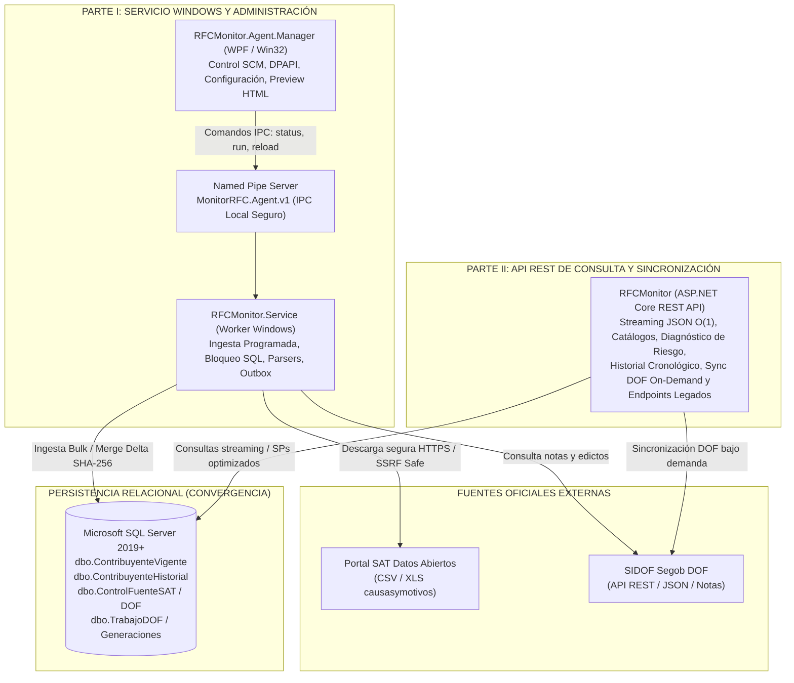
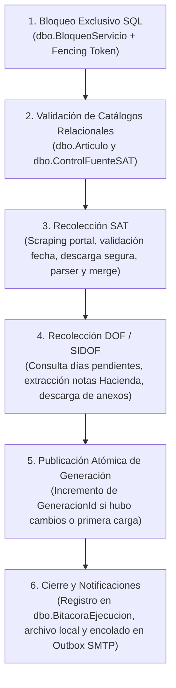
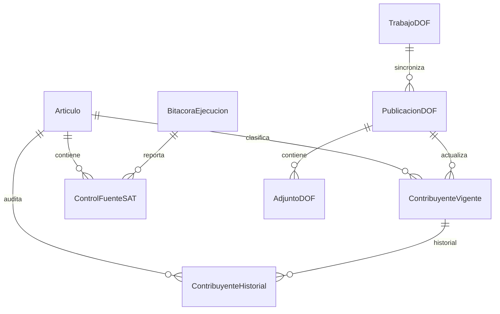

# RFCMonitor

Solución empresarial en **.NET 9** de alto rendimiento diseñada para la recolección automatizada, verificación criptográfica, análisis estructurado, persistencia relacional y consulta masiva de los listados públicos de contribuyentes emitidos por el **Servicio de Administración Tributaria (SAT)** y las publicaciones del **Diario Oficial de la Federación (DOF / SIDOF)**.

Consolida funcional y técnicamente las capacidades de recolección de `EdosSatScraper` y la API de consulta de `RfcStatusApi` en una arquitectura unificada, segura y resiliente.

---

## Arquitectura Global de la Solución



---

# PARTE I: SERVICIO WINDOWS Y ADMINISTRACIÓN

Esta sección documenta la capa operativa de recolección en segundo plano (`RFCMonitor.Service`) y su consola administrativa de escritorio (`RFCMonitor.Agent.Manager`).

---

## 1. Responsabilidad y Flujo Operativo del Servicio

El servicio de Windows **`RFCMonitor.Service`** se ejecuta de manera continua y desatendida bajo la cuenta `NT AUTHORITY\NetworkService`. Es el responsable exclusivo de la recolección periódica, validación criptográfica, detección de deltas, actualización histórica y publicación de generaciones consistentes.

### Ciclo Operativo de Ingesta (6 Pasos)



1. **Adquisición de Bloqueo Exclusivo en SQL Server**: Obtiene un candado de sesión en `dbo.BloqueoServicio` con token de cercado (*fencing token*). Si otra instancia o proceso mantiene el bloqueo, la ejecución se pospone de forma segura evitando condiciones de carrera.
2. **Sincronización de Catálogos en SQL**: Valida y garantiza la existencia de los catálogos base de artículos y fuentes SAT en la base de datos relacional.
3. **Recolección de Listados SAT**:
   - Descarga el catálogo HTML de Datos Abiertos del portal SAT (`contribuyentes_publicados.html`).
   - Extrae para cada listado la fecha oficial declarada (*"Información actualizada al dd de mes de aaaa"*).
   - Comprueba mediante `CheckUnchangedByDateAsync` si la fecha en base de datos ya coincide con la oficial. Si coincide, omite la descarga masiva y certifica el listado como `sin-cambios`.
   - Si la fecha es más reciente o no hay registro, descarga el archivo CSV/XLS vía `SafeDownloader`, calcula su resumen SHA-256, conserva la evidencia en disco y ejecuta el parser.
   - Aplica el merge relacional mediante `dbo.AplicarCambiosSAT` calculando deltas fila por fila mediante hash SHA-256 binario.
4. **Recolección del Diario Oficial de la Federación (DOF)**:
   - Consulta el servicio oficial SIDOF (`https://sidof.segob.gob.mx/dof/sidof/notas/{fecha}`).
   - Identifica días pendientes según la fecha inicial configurada y el historial en `dbo.ControlCoberturaDOF`.
   - Extrae notas relevantes emitidas por la Secretaría de Hacienda y Crédito Público (SHCP / SAT).
   - Analiza el contenido con `DofParser` para extraer tablas de contribuyentes, clasificar artículos fiscales (69, 69-B, 69-B Bis, 49-Bis) y registrar estatus (Presuntos, Definitivos, Desvirtuados, Sentencias favorables).
   - Descarga y preserva anexos PDF/imágenes en `data/evidence`. Si una nota requiere inspección manual, la registra en `dbo.NotaPendienteDOF`.
5. **Publicación Atómica de Generación**:
   - Si al menos una fuente registró el resultado `cambios` o si la base de datos aún no cuenta con una generación publicada, invoca `dbo.PublicarGeneracion`.
   - Las consultas de la API operan exclusivamente sobre la última generación activa publicada, garantizando consistencia relacional e inmutabilidad.
6. **Cierre de Bitácora y Notificaciones**:
   - Registra el resumen en `dbo.BitacoraEjecucion` y en el historial local JSON (`data/executions/{id}.json`).
   - Encola el reporte de resultados en el Outbox transaccional de correo para su posterior despacho.

---

## 2. Fuentes de Información y Seguridad en Descargas

### 2.1. Catálogo SAT de Fuentes Recolectadas

El Worker monitorea 17 listados oficiales del SAT:

| Identificador (Key) | Artículo | Nombre Oficial | Formato / Documento |
| :--- | :---: | :--- | :---: |
| `sat:69:cancelados` | 69 | Cancelados | CSV |
| `sat:69:reduccion-multas-74` | 69 | Reducción de multas (Art. 74 CFF) | CSV |
| `sat:69:condonados-concurso-146b` | 69 | Condonados concurso mercantil (Art. 146-B CFF) | CSV |
| `sat:69:reduccion-recargos-21` | 69 | Reducción de recargos (Art. 21 CFF) | CSV |
| `sat:69:condonados-decreto-2015` | 69 | Condonados por decreto 2015 | CSV |
| `sat:69:condonados-2007-2015` | 69 | Condonados 2007 a 2015 | CSV |
| `sat:69:cancelados-146a-2007-2015` | 69 | Cancelados Art. 146-A (2007 a 2015) | CSV |
| `sat:69:retorno-inversiones` | 69 | Retorno de inversiones | CSV |
| `sat:69:exigibles` | 69 | Exigibles | CSV |
| `sat:69:firmes` | 69 | Firmes | CSV |
| `sat:69:no-localizados` | 69 | No localizados | CSV |
| `sat:69:sentencias` | 69 | Sentencias condenatorias | CSV |
| `sat:69:csd-sin-efectos` | 69 | Certificados de Sello Digital sin efectos | CSV |
| `sat:69:entes-publicos-omisos` | 69 | Entes públicos omisos | CSV |
| `sat:69-b:listado-completo` | 69-B | Listado completo 69-B (EFOS) | CSV |
| `sat:69-b-bis:listado-completo` | 69-B Bis | Listado completo 69-B Bis (Pérdidas fiscales) | CSV |
| `sat:69:documento-tecnico` | 69 | Documento técnico de causas y motivos | XLS |

### 2.2. Seguridad en Descargas (`SafeDownloader`)

Para mitigar riesgos de red y ataques de falsificación de peticiones del lado del servidor (**SSRF**):
- **Validación de IPs Públicas**: Resuelve DNS antes de conectar y descarta direcciones loopback, privadas (RFC 1918), link-local, multicast o no enrutables.
- **Restricción HTTPS**: Exige esquema HTTPS estricto en el puerto 443.
- **Lista Blanca de Dominios**: Solo permite conexiones a `www.sat.gob.mx`, `sat.gob.mx`, `wu1agsprosta001.blob.core.windows.net`, `sidof.segob.gob.mx` y `www.dof.gob.mx`.
- **Límites de Descarga y Hash Streaming**: Impone cuota máxima en bytes y computa el hash SHA-256 de forma incremental en memoria mientras escribe el archivo en disco temporal.

---

## 3. Parsers y Detección de Deltas por Hash SHA-256

### 3.1. Normalización y Parsers
- **`SatParser`**:
  - Detección automática de codificación: UTF-8 con/sin BOM, con fallback automático a Windows-1252.
  - Localización dinámica de encabezados: Escanea las primeras 40 filas hasta localizar la fila que contiene `RFC`, permitiendo tolerar preámbulos informativos del SAT.
  - Normalización de RFCs: Remueve espacios, apóstrofes, comillas tipográficas, caracteres invisibles y sustituye variantes como `¥` por `Ñ`.
  - Extracción completa: Mapea montos numéricos, fechas de publicación, ejercicios, periodos, motivos, números de oficio SAT/DOF y etapas de presunción, definitividad, desvirtuación o sentencia.
- **`DofParser`**:
  - Procesa notas HTML mediante `HtmlAgilityPack`.
  - Clasifica la relevancia jurídica y el artículo correspondiente (69, 69-B, 69-B Bis, 49-Bis).
  - Detecta la situación jurídica del contribuyente a partir del contexto textual (`Definitivo`, `Presunto`, `Desvirtuado`, `Sentencia favorable`).

### 3.2. Detección de Deltas por Hash Binario SHA-256
Cada fila normalizada en `ContribuyenteDatos` ejecuta `ComputeHash()`, generando un resumen SHA-256 de 32 bytes (`VARBINARY(32)`). El procedimiento almacenado `dbo.AplicarCambiosSAT` utiliza este hash para comparar en bloque (*set-based*) contra `dbo.ContribuyenteVigente`:
- Filas nuevas se insertan directamente en `dbo.ContribuyenteVigente` y se auditan en `dbo.ContribuyenteHistorial`.
- Filas modificadas actualizan la situación y los oficios en `dbo.ContribuyenteVigente` y registran el evento en `dbo.ContribuyenteHistorial`.
- Filas idénticas no generan escrituras redundantes ni aumentan el log de transacciones.

---

## 4. Programación, Control IPC y Notificaciones

### 4.1. Modos de Programación (`ScheduleCalculator`)
Configurados en el Manager y ejecutados en el Worker:
- **`interval`**: Ejecución cada $N$ minutos.
- **`daily-hours`**: Ejecución diaria en horas específicas (predeterminado: `08:00; 20:00` en zona `America/Mexico_City`).
- **`daily`**: Ejecución diaria a una hora fija (`HH:mm`).
- **`weekly`**: Ejecución en días específicos de la semana a una hora fija.
- **`cron`**: Expresión cron avanzada de 5 campos evaluada mediante la librería `Cronos`.

### 4.2. Servidor IPC Local por Named Pipe (`AgentPipe`)
El Worker expone el Named Pipe local `\\.\pipe\MonitorRFC.Agent.v1` protegido con ACLs de Windows:
- Permite acceso exclusivo a administradores locales (`BuiltinAdministrators`), `LocalSystem` y al usuario actual.
- Deniega explícitamente cualquier acceso desde la red (`NetworkSid`).
- Comandos soportados:
  - `status`: Consulta en tiempo real si el servicio está ejecutando, la fecha de la próxima ejecución, el último reporte y correos pendientes.
  - `run`: Encola una ejecución inmediata con disparador `manual`.
  - `reload`: Recarga la configuración de disco sin detener el servicio.

### 4.3. Despachador Transaccional de Correo (`EmailOutbox`)
- Implementa el patrón Outbox: Las notificaciones pendientes se guardan como archivos JSON en `data/outbox/`.
- El servicio intenta el envío vía SMTP (StartTLS o SSL) mediante `MailKit`.
- En caso de indisponibilidad del servidor SMTP, reintenta con retroceso exponencial sin perder la notificación.
- Al completarse el envío, traslada el archivo a `data/mail-sent/`.
- Notificaciones de Ciclo de Vida: Envía correos informativos inmediatos cuando el servicio se **Inicia** o se **Detiene**.

---

## 5. Consola Administrativa Elevada (`RFCMonitor.Agent.Manager`)

Aplicación de escritorio en WPF con elevación administrativa (UAC):
- **Administración del Servicio (`ServiceAdministration`)**: Utiliza P/Invoke sobre la API de Windows SCM (`advapi32.dll`) para instalar, desinstalar, actualizar binarios, iniciar, detener y reiniciar el servicio `MonitorRFC.Service` sin necesidad de comandos de consola.
- **Cifrado de Credenciales (DPAPI)**: Construye y cifra la cadena de conexión a SQL Server y la contraseña SMTP utilizando `ProtectedData` en el ámbito `LocalMachine`. La configuración resultante se almacena en `C:\Servicios\MonitorRFC\config\agentsettings.json`.
- **Previsualización de Correo (`EmailPreview`)**: Sanitiza el contenido HTML de la plantilla (eliminando scripts, iframes y contenido externo) y genera un `FlowDocument` nativo para previsualizar el diseño antes de guardarlo.

---

## 6. Documentación de Clases y Métodos del Servicio y Manager

### Componentes de `RFCMonitor.Service`
- **`AgentWorker`**:
  - `Command(string action)`: Procesa comandos IPC (`status`, `run`, `reload`).
  - `ExecuteAsync(CancellationToken stoppingToken)`: Bucle principal del servicio en segundo plano.
  - `RunCycleAsync(AgentOptions settings, string trigger, CancellationToken ct)`: Ejecuta el ciclo de 6 fases de ingesta.
  - `StopAsync(CancellationToken cancellationToken)`: Maneja el apagado ordenado y envía la alerta de servicio detenido.
- **`AgentPipe`**:
  - `ExecuteAsync(CancellationToken ct)`: Servidor asíncrono de Named Pipe con seguridad ACL.

### Componentes de `RFCMonitor.Agent.Manager`
- **`ServiceAdministration`**:
  - `Status()`: Retorna el estado actual del servicio en el SCM.
  - `Execute(string action, string binary)`: Ejecuta operaciones de control (`install`, `uninstall`, `update`, `start`, `stop`, `restart`).
- **`ManagerViewModel`**:
  - Propiedades reactivas para conexión SQL, fuentes habilitadas, programación, SMTP y diagnóstico.
  - `ExecuteAsync(string command)`: Envía comandos al servicio por el Named Pipe.
- **`EmailPreview`**:
  - `SafeHtml(string html)`: Elimina etiquetas de riesgo de la plantilla.
  - `Render(string html)`: Construye el `FlowDocument` para visualización WPF.

### Componentes Compartidos de Infraestructura del Servicio
- **`SatCollector`**: `RunAsync(AgentOptions options, CancellationToken ct)`.
- **`DofCollector`**: `RunAsync(AgentOptions options, CancellationToken ct)`.
- **`SatParser`**: `ReadAsync(...)`, `ReadWorkbookAsync(...)`, `DetectEncoding(...)`, `ParseDate(...)`.
- **`DofParser`**: `Parse(string title, string html, DateOnly date)`.
- **`SafeDownloader`**: `FetchAsync(...)`, `TextAsync(...)`, `ValidateUri(...)`, `IsPublic(...)`.
- **`EmailOutbox`**: `EnqueueAsync(...)`, `DispatchAsync(...)`, `SendAsync(...)`, `SendServiceLifecycleAsync(...)`.
- **`ScheduleCalculator`**: `Next(...)`, `Validate(...)`, `Zone(...)`.
- **`AgentConfiguration`**: `Load()`, `Save(...)`, `Protect(...)`, `Unprotect(...)`, `SecureDirectory(...)`.
- **`RollingFileLoggerProvider`**: Registro rotativo diario con compresión `.zip` y retención de 15 días.

---

# PARTE II: API REST DE CONSULTA Y SINCRONIZACIÓN

Esta sección documenta la API REST consolidada (`RFCMonitor`) expuesta para el consumo de aplicaciones clientes, microservicios y sistemas legados.

---

## 1. Responsabilidad y Arquitectura del API

La API REST **`RFCMonitor`** está desarrollada en ASP.NET Core (`net9.0`) orientada a disponibilidad continua y máxima eficiencia de memoria:
- **Streaming JSON en $O(1)$ de Memoria**: A través de `RfcStreamResult`, `HierarchicalContribuyenteStreamResult`, `LegacyAllResult` y `LegacyAll69Result`, la API serializa los registros conforme se leen desde SQL Server y los escribe directamente al flujo de red (`PipeWriter`), evitando acumular millones de registros en colecciones en memoria.
- **Compresión de Respuesta**: Negocia compresión automática mediante Brotli y Gzip para clientes que lo soporten en peticiones masivas.
- **Limitación de Concurrencia (Rate Limiting)**: Implementa control de consultas simultáneas (`AddConcurrencyLimiter`) para proteger la base de datos de saturación.
- **Sincronización DOF Integrada (`DofJobService`)**: Cuenta con un motor de trabajos en segundo plano dentro de la propia API, permitiendo lanzar sincronizaciones del DOF bajo demanda sin depender del Worker de Windows.

---

## 2. Catálogo Oficial de Artículos y Listados Fiscales

La API expone y normaliza la taxonomía fiscal del SAT y DOF:

### 2.1. Artículos Fiscales (IDs 1 al 4)
- **ID 1 (`69`)**: Incumplidos, créditos cancelados, condonados, exigibles, firmes, sentencias y CSD sin efectos.
- **ID 2 (`69-b`)**: Operaciones inexistentes y facturación apócrifa (EFOS).
- **ID 3 (`69-b-bis`)**: Transmisión indebida de pérdidas fiscales.
- **ID 4 (`49-bis`)**: Presunción de falsedad en comprobantes de nómina (publicaciones DOF).

### 2.2. Listados y Supuestos Oficiales (IDs 1 al 24)
- **Art. 69**: `cancelados` (1), `reduccion-multas-74` (2), `condonados-concurso-146b` (3), `reduccion-recargos-21` (4), `condonados-decreto-2015` (5), `condonados-2007-2015` (6), `cancelados-146a-2007-2015` (7), `retorno-inversiones` (8), `exigibles` (9), `firmes` (10), `no-localizados` (11), `sentencias` (12), `csd-sin-efectos` (13), `entes-publicos-omisos` (14), `documento-tecnico` (18).
- **Art. 69-B**: `definitivos` (15), `desvirtuados` (16), `presuntos` (17), `sentencias-favorables` (19), `listado-completo` (20), `publicaciones-dof` (21).
- **Art. 69-B Bis**: `listado-completo` (22), `publicaciones-dof` (23).
- **Art. 49-Bis**: `publicaciones-dof` (24).

---

## 3. Catálogo Exhaustivo de Endpoints Disponibles

### 3.1. Diagnóstico y Salud

| Método | Ruta | Descripción | Entrada | Respuesta |
| :--- | :--- | :--- | :--- | :--- |
| `GET` | `/` | Comprobación base de servicio online. | Ninguna | `200 OK` `{ servicio: "MonitorRFC", estado: "online" }` |
| `GET` | `/health/live` | Sonda de vida (Liveness). | Ninguna | `200 OK` `{ estado: "online" }` |
| `GET` | `/health/ready` | Sonda de disponibilidad (Readiness). Valida que exista al menos una generación publicada en base de datos. | Ninguna | `200 OK` `{ estado: "ready" }`<br/>`503 Service Unavailable` si no hay generación activa. |

### 3.2. Catálogos y Estado de Fuentes

| Método | Ruta | Descripción | Parámetros | Respuesta |
| :--- | :--- | :--- | :--- | :--- |
| `GET` | `/api/v1/catalogos` | Catálogo jerárquico completo de Artículos y sus Listados asociados con totales. | Ninguno | `200 OK` `{ articulos: [...], totalArticulos: 4, totalListados: 24 }` |
| `GET` | `/api/v1/catalogos/articulos` | Catálogo plano de los 4 artículos fiscales soportados. | Ninguno | `200 OK` `[ { articuloId, clave, nombre, descripcion }, ... ]` |
| `GET` | `/api/v1/catalogos/listados` | Catálogo plano de los 24 listados/supuestos. Permite filtrar por artículo. | Query: `articuloId` (int) o `articulo` (string). | `200 OK` `[ { listadoId, articuloId, clave, nombre, ... }, ... ]` |
| `GET` | `/api/v1/articulos` | Claves textuales soportadas (`69`, `69-b`, `69-b-bis`, `49-bis`). | Ninguno | `200 OK` `["69", "69-b", "69-b-bis", "49-bis"]` |
| `GET` | `/api/v1/articulos/{articulo}/listados` | Listados y supuestos disponibles para un artículo dado (SAT y DOF). | Path: `articulo` | `200 OK` `[ { clave, nombre, fuente }, ... ]` |
| `GET` | `/api/v1/tipos` | Catálogo legado de 22 tipos fiscales numéricos. | Ninguno | `200 OK` `[ { tipoId: 1, clave, articulo, listado, ... }, ... ]` |
| `GET` | `/api/v1/tipos/{tipoId}` | Detalle de un tipo fiscal numérico específico (1..22). | Path: `tipoId` | `200 OK` `{ tipoId, clave, articulo, listado, ... }`<br/>`404 Not Found` si no existe. |
| `GET` | `/api/v1/fuentes/estado`<br/>*(Alias: `/api/v1/descargas/estado`)* | Estado operativo detallado de fuentes SAT y DOF: fecha de portal, última descarga, conteos y cobertura DOF. | Ninguno | `200 OK` Resumen operativo y métricas. |

### 3.3. Consultas de Contribuyentes y RFCs

| Método | Ruta | Descripción | Parámetros / Entrada | Formato de Respuesta |
| :--- | :--- | :--- | :--- | :--- |
| `GET` | `/api/v1/contribuyentes`<br/>*(Aliases: `/api/v1/contribuyentes/global`, `/api/v1/rfcs/global`)* | Listado jerárquico estructurado (`articulos` -> `listados` -> `contribuyentes`) con streaming JSON en $O(1)$ de memoria. Expone todas las columnas relacionales reales (oficios SAT/DOF, etapas 69-B, montos, ejercicios, metadatos y enlaces al DOF). | Query opcional: `tipoId`, `articuloId`, `articulo`, `listadoId`, `listado`, `situacion`. | Streaming JSON: `{ versionContrato: "2.0", filtro, articulos: [ { articuloId, clave, listados: [ { listadoId, contribuyentes: [ ... ] } ] } ], totales }` |
| `GET` | `/api/v1/tipos/{tipoId}/contribuyentes` | Consulta de contribuyentes asociados a un tipo fiscal numérico legacy. | Path: `tipoId`<br/>Query: `incluirHistorial` (bool). | Streaming JSON consolidado. |
| `POST` | `/api/v1/rfcs/estado` | Diagnóstico integral de riesgo para un arreglo de RFCs (`Critico`, `Presunto`, `Favorable`, `Informativo`, `Limpio`), artículos donde aparece, fecha efectiva más reciente, oficios SAT/DOF, etapas fiscales y apariciones vigentes. | Body: `["RFC1", "RFC2"]` o `{ "rfcs": ["..."] }`<br/>Query: `articuloId`, `articulo`, `listadoId`, `listado`. | `200 OK` `{ totalSolicitados, totalEncontrados, contribuyentes: [ { rfc, razonSocial, diagnosticoRiesgo, esDefinitivo, esPresunto, apariciones: [...] } ] }` |
| `POST` | `/api/v1/rfcs/historial` | Trazabilidad histórica completa para un arreglo de RFCs, ordenado en sentido **estrictamente ascendente por fecha**. | Body: `["RFC1", "RFC2"]` o `{ "rfcs": ["..."] }`<br/>Query: `articuloId`, `articulo`, `listadoId`, `listado`. | `200 OK` `{ totalSolicitados, contribuyentes: [ { rfc, totalMovimientos, movimientos: [ { fecha, situacion, origen, oficios, dof } ] } ] }` |
| `GET` | `/api/v1/rfcs` | Consulta consolidada de todos los RFCs de la última generación en streaming JSON. | Query: `incluirHistorial` (bool). | Streaming JSON consolidado. |
| `POST` | `/api/v1/rfcs/consultar` | Consulta masiva consolidada de RFCs. | Body: `["RFC1"]` o `{ "rfcs": [...] }`<br/>Query: `articulo`, `listado`, `incluirHistorial`. | Streaming JSON consolidado. |
| `GET` | `/api/v1/rfcs/{rfc}/estatus` | Estatus vigente de un RFC individual. | Path: `rfc` | Streaming JSON. |
| `GET` | `/api/v1/rfcs/{rfc}/historial` | Historial cronológico ascendente de un RFC. | Path: `rfc`<br/>Query: `articulo`, `listado`. | Streaming JSON. |
| `GET` | `/api/v1/articulos/{articulo}/contribuyentes` | Contribuyentes vigentes de un artículo. | Path: `articulo`<br/>Query: `incluirHistorial`. | Streaming JSON. |
| `GET` | `/api/v1/articulos/{articulo}/listados/{listado}/contribuyentes` | Contribuyentes de un artículo y listado concreto. | Path: `articulo`, `listado`<br/>Query: `incluirHistorial`. | Streaming JSON. |

### 3.4. Sincronización On-Demand del DOF

| Método | Ruta | Descripción | Parámetros / Entrada | Formato de Respuesta |
| :--- | :--- | :--- | :--- | :--- |
| `POST` | `/api/v1/dof/sincronizar`<br/>*(Alias: `/api/v1/dof/descargar`)* | Encola en segundo plano (dentro de la propia API mediante `DofJobService`, independiente del Worker) la sincronización DOF del periodo. Admite ejecución síncrona con `esperar=true`. | Query o Body JSON: `fechaInicio` (`yyyy-MM-dd`), `fechaFin` (`yyyy-MM-dd`), `articulo` (opcional), `esperar` (bool). | **Asíncrono (predeterminado):** `202 Accepted` `{ trabajoId, estado: "en_cola", consultarEstadoEn }`<br/>**Síncrono:** `200 OK` con `DofSyncResponse`. |
| `GET` | `/api/v1/dof/sincronizar/{trabajoId}`<br/>*(Alias: `/api/v1/dof/descargar/{trabajoId}`)* | Estado y avance en tiempo real del trabajo (`en_cola`, `en_curso`, `completado`, `error`, `interrumpido`), `diaActual`, `totalDias`, `porcentajeAvance` y resumen de resultados. | Path: `trabajoId` (GUID) | `200 OK` `{ trabajoId, estado, diaActual, totalDias, porcentajeAvance, resultado }`<br/>`404 Not Found` si no existe. |

### 3.5. Documentos Técnicos

| Método | Ruta | Descripción | Parámetros | Formato |
| :--- | :--- | :--- | :--- | :--- |
| `GET` | `/api/v1/articulos/69/documento-tecnico`<br/>*(Alias: `/api/v1/documentos/69/documento-tecnico`)* | Obtiene la matriz técnica de celdas del archivo normativo de causas y motivos del Artículo 69 (`causasymotivos.xls`) para la generación activa. | Ninguno | `200 OK` `{ generacionId, celdas: [ { hoja, fila, columna, valor, formula, comentario } ] }` |

### 3.6. Endpoints de Compatibilidad Legada (`RfcStatusApi`)

| Método | Ruta | Descripción | Parámetros / Entrada | Formato de Respuesta |
| :--- | :--- | :--- | :--- | :--- |
| `POST` | `/api/Rfc/Edos-Efos` | Consulta por RFC con artículos concatenados (ej. `69-b, 69 (Cancelados, Exigibles)`). Devuelve exactamente la estructura legada esperada por clientes históricos. Respaldado por `dbo.PA_Legacy_EdosEfos_Consultar`. | Body JSON: `["RFC1"]` o `{ "rfcs": ["..."] }` (hasta 10,000 RFCs). | `{ success, message, resultado: { informacionConsulta, data: [ { rfc, nombreContribuyente, estatus, numeroFechaOficioSAT, publicacionPaginaSAT, numeroFechaOficioGlobal, publicacionDOF, articulo } ] } }` |
| `GET` | `/api/EdosEfos/all` | Exportación completa sin paginación de 69-B y 69-B Bis en streaming JSON. Respaldado por `dbo.PA_Legacy_EdosEfos_All`. | Ninguno | Streaming JSON con las 16 columnas oficiales de folios/publicaciones SAT y DOF por etapa. |
| `GET` | `/api/EdosEfos/all69` | Consulta global paginada de todos los artículos y listados. Respaldado por `dbo.PA_Legacy_EdosEfos_All69`. | Query: `pagina` (int, default 1), `tamanoPagina` (int, default y max 10,000), `tipoId` (int, filtro por catálogo legacy). | Streaming JSON paginado con metadatos extendidos `informacionConsulta69`. |
| `POST` | `/api/Rfc/Listado69` | Alias heredado de consulta masiva sobre la API v1. | Body: `{ "rfcs": ["..."] }`<br/>Query: `incluirHistorial`. | Formato compatible v1. |

---

## 4. Documentación de Clases y Métodos del API

### Controladores y Respuestas de Streaming
- **`RfcsController`**: Controlador principal de la API v1.
  - Endpoints de catálogos (`CatalogosJerarquicos`, `CatalogosArticulos`, `CatalogosListados`, `GetTypes`, `GetTypeById`).
  - Endpoints de contribuyentes y RFCs (`Contribuyentes`, `StatusByRfcs`, `HistoryByRfcs`, `ByArticle`, `CurrentStatus`, `History`, `Document`).
  - Endpoints de sincronización DOF (`SyncDof`, `SyncDofStatus`).
- **`LegacyController`**: Controlador de compatibilidad retroactiva.
  - `EdosEfos(JsonElement body, CancellationToken ct)`: Ejecuta la consulta de RFCs con formato y campos legados.
  - `All()`: Invoca `LegacyAllResult` para el streaming completo de 69-B.
  - `All69(int? pagina, int? tamanoPagina, int? tipoId)`: Invoca `LegacyAll69Result` para la paginación global.
- **Resultados Personalizados de Streaming en $O(1)$ de Memoria**:
  - `HierarchicalContribuyenteStreamResult`: Serializa el JSON jerárquico estructurado (`articulos` -> `listados` -> `contribuyentes`) directamente al `PipeWriter` con conteos intermedios.
  - `GlobalContribuyenteStreamResult`: Serializa una lista plana de contribuyentes en streaming.
  - `RfcStreamResult`: Serializa la respuesta consolidada de RFCs evaluando discrepancias de estado.
  - `LegacyAllResult`: Escribe el streaming directo del procedimiento `dbo.PA_Legacy_EdosEfos_All`.
  - `LegacyAll69Result`: Escribe el streaming directo paginado de `dbo.PA_Legacy_EdosEfos_All69`.

### Dominio y Utilidades del API
- **`CatalogoTipos`**: Métodos estáticos de normalización y mapeo (`NormalizarArticulo`, `NormalizarListado`, `ResolverListadoId`, `ObtenerPorId`).
- **`ContribuyenteDatos`**: Modelo relacional maestro; provee `ComputeHash()` para el cálculo binario SHA-256.
- **`Rfc`**: Métodos `Normalize()`, `IsStrictRfc()`, `ValidateMany()`.
- **`TextKey`**: Normalización diacrítica y alfanumérica.
- **`Consolidation`**: Agrupación y colapso de apariciones redundantes entre SAT y DOF.

### Persistencia y Motor de Sincronización DOF de la API
- **`SqlRepository`**: Data access para consultas de contribuyentes, estado de fuentes, historial cronológico y procedimientos de sincronización.
- **`LegacyRepository`**: Data access para invocación directa de procedimientos almacenados legados hacia `PipeWriter`.
- **`DofJobQueue`**: Cola en memoria respaldada por `System.Threading.Channels.Channel<DofJobRequest>`.
- **`DofJobService`**: `BackgroundService` que procesa solicitudes DOF en cola, persiste el estado en `dbo.TrabajoDOF` y maneja recuperaciones automáticas ante reinicios de la API.

---

# PARTE III: CONVERGENCIA TÉCNICA, MODELO RELACIONAL Y SEGURIDAD

Esta sección documenta los elementos compartidos que articulan tanto al Servicio de Ingesta como a la API de Consulta.

---

## 1. Modelo de Base de Datos (SQL Server)

La base de datos opera íntegramente sobre el esquema `dbo` en **Microsoft SQL Server 2019 o posterior** (compatibilidad 150+). El stack de persistencia usa SQL Server, T-SQL *set-based*, TVP para lotes de RFC, índices relacionales y hashes SHA-256 calculados por la aplicación .NET 9; no requiere SQL Agent, CLR, usuarios, roles ni secretos en los scripts.

`database/bootstrap.sql` se conserva como el bootstrap autocontenido y canónico. `database/objects` contiene el mismo modelo separado por objeto para revisión, despliegue versionado y diagnóstico; `database/reset.sql` elimina únicamente objetos de MonitorRFC del esquema `dbo` para pruebas.

### Organización y orden de despliegue

Los archivos de `database/objects` se ejecutan en orden léxico ascendente. El prefijo numérico representa la dependencia: `00` tipo de tabla; `10`–`21` tablas, semillas y sus índices; `30`–`41` procedimientos de ingesta y consulta; `50`–`53` vistas de compatibilidad; `60`–`62` procedimientos legados que consumen esas vistas. Cada archivo contiene un solo objeto lógico, incluyendo sus alteraciones de compatibilidad, índices y semillas cuando corresponda.

```powershell
# Instalación/reconstrucción autocontenida
sqlcmd -S SERVIDOR -d MonitorRFC -E -b -i .\database\bootstrap.sql

# Despliegue por objetos independientes
Get-ChildItem .\database\objects\*.sql | Sort-Object Name |
    ForEach-Object { sqlcmd -S SERVIDOR -d MonitorRFC -E -b -i $_.FullName }
```



### 1.1. Tablas y Responsabilidad
- **`dbo.Articulo`**: Catálogo semilla de los 4 artículos fiscales soportados (`69`, `69-b`, `69-b-bis`, `49-bis`); su clave primaria es `Clave` y el orden de presentación se guarda en `Orden`.
- **`dbo.ControlFuenteSAT`**: Estado operativo de fuentes SAT: URL, hash del archivo, fecha de portal, última descarga exitosa, conteos y métricas.
- **`dbo.ContribuyenteVigente`**: Padrón activo y consolidado de contribuyentes por artículo y listado. Permite múltiples registros publicados por RFC/listado, cuenta con índices por RFC, artículo/listado, hash y fecha, y almacena el resumen SHA-256 en `HashFila BINARY(32)`.
- **`dbo.ContribuyenteHistorial`**: Auditoría histórica inmutable (append-only) de cada alta, cambio de situación fiscal o sentencia.
- **`dbo.PublicacionDOF`**: Edictos y notas oficiales extraídas de SIDOF con `CodNota` como clave primaria, edición, título, fecha y un índice por fecha/artículo.
- **`dbo.ControlCoberturaDOF`**: Seguimiento diario de cobertura del DOF para evitar vacíos cronológicos.
- **`dbo.TrabajoDOF`**: Estado, rango de fechas, progreso porcentual y resultados JSON de sincronizaciones DOF bajo demanda.
- **`dbo.NotaPendienteDOF`**: Registro de notas del DOF que requieren revisión manual por formato atípico.
- **`dbo.AdjuntoDOF`**: Metadatos y rutas de almacenamiento de documentos PDF o imágenes anexas al DOF.
- **`dbo.DocumentoTecnico69`**: Matriz de celdas del documento técnico normativo del Artículo 69 (`causasymotivos.xls`), identificada por la clave compuesta hoja/fila/columna ordinal.
- **`dbo.BitacoraEjecucion`**: Bitácora auditable de ejecuciones del Worker (fechas, duración, resultado, métricas).
- **`dbo.BloqueoServicio`**: Candado de sesión exclusivo para serializar la ingesta y evitar colisiones concurrentes, identificado por `Recurso` y protegido con `Propietario`, `FencingToken` y expiración.
- **`dbo.RfcInput` (TVP)**: Tipo de tabla en memoria (`Rfc NVARCHAR(100)` con colación binaria y `OrdenEntrada`) para consultas masivas que conservan el orden de la petición.

### 1.2. Procedimientos Almacenados y Vistas
- **Ingesta y control**: `dbo.AplicarCambiosSAT` aplica el delta SAT; `dbo.AplicarPublicacionDOF` integra notas DOF; `dbo.PublicarGeneracion` confirma una generación consistente.
- **Consultas API**: `dbo.ConsultarContribuyentesVigentes`, `dbo.ConsultarContribuyenteHistorial`, `dbo.ConsultarHistorialRfcs` y `dbo.ConsultarEstatusGeneral` devuelven datos actuales, históricos y riesgo; `dbo.Encabezado`, `dbo.Apariciones` y `dbo.Conteos` abastecen los resultados de streaming; `dbo.DocumentoTecnico` y `dbo.EstadoFuentes` entregan la matriz técnica y salud de fuentes.
- **Vistas de compatibilidad**: `dbo.vw_LegacyRfcDetalle`, `dbo.vw_LegacyRfcArticulos`, `dbo.vw_LegacyNoLocalizados` y `dbo.vw_LegacyInfoFuentes` adaptan los datos vigentes al contrato histórico.
- **Procedimientos legados**: `dbo.PA_Legacy_EdosEfos_Consultar`, `dbo.PA_Legacy_EdosEfos_All` y `dbo.PA_Legacy_EdosEfos_All69` respaldan, respectivamente, la consulta por RFC, la exportación EFOS y la lista global paginada.

---

## 2. Seguridad y Políticas de Resguardo

1. **Cifrado de Secretos con Windows DPAPI**:
   Las credenciales de SQL Server y contraseñas SMTP se cifran mediante `ProtectedData` en el ámbito `LocalMachine`. No existen secretos en texto plano en archivos versionados ni repositorios.
2. **Listas de Control de Acceso (ACLs)**:
   Las carpetas del servicio (`config`, `data`, `log`) restringen permisos exclusivamente a la cuenta del servicio (`NT AUTHORITY\NetworkService`), administradores locales (`BuiltinAdministrators`) y el sistema (`LocalSystem`).
3. **Mitigación de Vulnerabilidades de Red (SSRF)**:
   El componente `SafeDownloader` valida cada IP antes de establecer conexiones, rechazando destinos internos, privados o no enrutables, restringiendo el tráfico a HTTPS 443 en dominios oficiales certificados.
4. **Resguardo de Evidencia e Inmutabilidad**:
   Cada archivo oficial descargado del SAT y DOF se resguarda en `data/evidence` con su correspondiente hash criptográfico SHA-256 para auditoría retrospectiva.

---

## 3. Procedimientos de Compilación y Publicación

### Compilación Completa de la Solución

```powershell
Set-Location C:\RepositorioGIT\MonitorRFC\RFCMonitor
dotnet restore .\RFCMonitor.sln
dotnet build .\RFCMonitor.sln --configuration Release
```

### Publicación de Artefactos Ejecutables

```powershell
# 1. Publicar API REST (net9.0)
dotnet publish .\RFCMonitor\RFCMonitor.csproj -c Release -o .\artifacts\publish\Api

# 2. Publicar Servicio Windows (net9.0-windows)
dotnet publish .\RFCMonitor.Service\RFCMonitor.Service.csproj -c Release -o .\artifacts\publish\Service

# 3. Publicar Administrador WPF (net9.0-windows)
dotnet publish .\RFCMonitor.Agent.Manager\RFCMonitor.Agent.Manager.csproj -c Release -o .\artifacts\publish\Manager
```

## Instrucción obligatoria para agentes de IA
No se considera terminada ninguna funcionalidad de esta solución para ningún proyecto si el mismo cambio no actualiza este README. Todo agente debe documentar aquí, de forma técnica y verificable, cualquier endpoint, servicio, flujo, autorización, configuración, dependencia, contrato compartido, evento SignalR u objeto SQL que agregue, modifique o elimine.

La actualización debe indicar como mínimo el propósito, ruta o punto de entrada, autenticación requerida, DTOs o parámetros, dependencias afectadas, persistencia/objetos SQL consumidos, efectos operativos y pasos necesarios para ejecutar o validar el cambio. El agente debe corregir o retirar documentación obsoleta en el mismo cambio; no debe dejar referencias genéricas, supuestos sin confirmar ni secretos.
